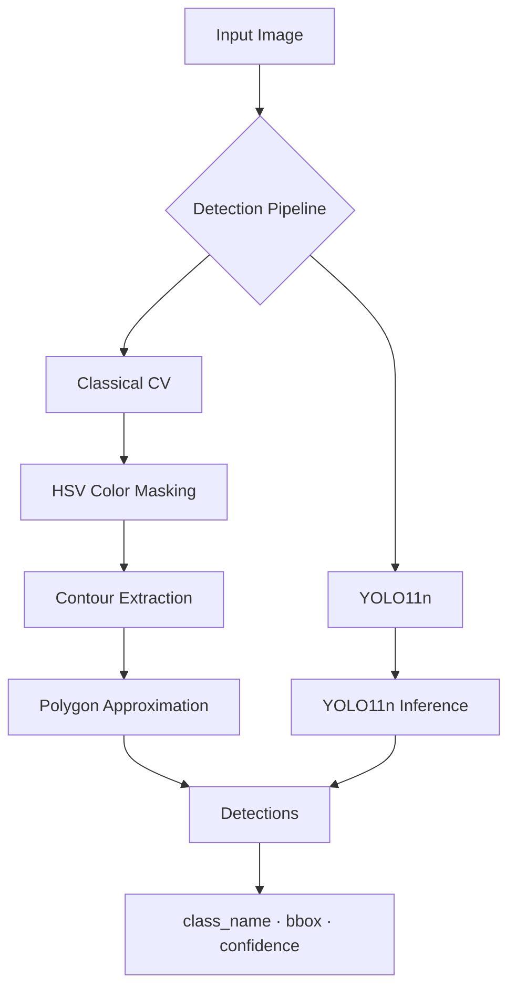

# Classical Computer Vision vs. YOLO11 — Shape & Color Detection

A structured comparison of two object detection approaches applied to a nine-class shape-and-color recognition problem. Built as the first phase of a larger AI-powered robotic sorting system, the project evaluates whether classical image processing or a fine-tuned neural network better serves the perception requirements of a robot arm.

---

## Table of Contents

- [Project Overview](#project-overview)
- [Key Features](#key-features)
- [Detection Classes](#detection-classes)
- [System Architecture](#system-architecture)
- [Methodology](#methodology)
- [Experimental Results](#experimental-results)
- [Results and Discussion](#results-and-discussion)
- [Project Structure](#project-structure)
- [Installation](#installation)
- [How to Run](#how-to-run)
- [REST API](#rest-api)
- [Limitations](#limitations)
- [Future Work](#future-work)
- [Technologies](#technologies)

---

## Project Overview

This project implements and benchmarks two fundamentally different computer vision pipelines for detecting geometric shapes and colors in synthetic images:

- **Classical CV** — hand-crafted image processing using OpenCV: HSV color segmentation, binary masking, contour extraction, and polygon approximation. No training data required.
- **YOLO11n** — a nano-scale YOLO11 model fine-tuned on a custom dataset. End-to-end learned detection with bounding boxes and confidence scores.

Both pipelines are evaluated on the same 150-image validation set using the same bounding-box matching protocol (IoU ≥ 0.50), and both are exposed through a shared FastAPI server for interactive testing.

The central question is straightforward: **how much accuracy do you gain from deep learning, and what does it cost in latency?**

---

## Key Features

- Two complete detection pipelines — classical CV and deep learning — built and evaluated in parallel
- Shared evaluation framework with greedy IoU-based matching for fair comparison
- FastAPI server with three endpoints: classical, YOLO11, and side-by-side comparison
- Per-image inference timing with disk I/O and warmup excluded from measurements
- Jupyter notebook documenting the classical CV exploration process
- Dataset and model weights excluded from version control via `.gitignore`

---

## Detection Classes

The system recognizes nine classes formed by combining three shapes with three colors:

| | Circle | Square | Triangle |
|---|---|---|---|
| **Red** | red_circle | red_square | red_triangle |
| **Blue** | blue_circle | blue_square | blue_triangle |
| **Green** | green_circle | green_square | green_triangle |

---

## System Architecture



Both pipelines produce the same output schema: a class label, a bounding box `(x1, y1, x2, y2)`, and optionally a confidence score (YOLO11 only).

---

## Methodology

### Classical Computer Vision

**File:** `classical_cv/classical_detector.py`

The pipeline runs in three stages:

**1. HSV Color Segmentation**
The input image is converted from BGR to HSV. Three binary masks are generated — one per color. Red requires two separate HSV ranges (hue wraps around 180°), which are merged with a bitwise OR.

| Color | Hue Range |
|---|---|
| Red | [0–10] ∪ [170–179] |
| Blue | [100–140] |
| Green | [35–85] |

**2. Contour Extraction**
`cv2.findContours` is called on each binary mask. Contours with an area below 300 px² are discarded to eliminate noise and small artefacts.

**3. Polygon Approximation**
`cv2.approxPolyDP` simplifies each contour with an epsilon equal to 4% of the perimeter. The vertex count of the resulting polygon determines the shape class:

| Vertices | Shape |
|---|---|
| 3 | Triangle |
| 4 | Square |
| ≥ 5 | Circle |

The detector returns a dictionary per detection containing the color, shape, class name, centroid, contour area, and axis-aligned bounding box.

---

### Deep Learning — YOLO11n

**Files:** `deep_learning/train_yolo.py` · `deep_learning/evaluate_yolo.py`

A YOLO11 nano model was fine-tuned on the custom dataset using the Ultralytics API.

**Training configuration:**

| Parameter | Value |
|---|---|
| Base weights | `yolo11n.pt` |
| Epochs | 50 |
| Image size | 640 × 640 |
| Batch size | 16 |
| Optimizer | Default (Ultralytics) |

**Inference configuration (evaluation and API):**

| Parameter | Value |
|---|---|
| Confidence threshold | 0.25 |
| Image size | 640 × 640 |
| Device | CPU |

Best checkpoint saved to: `deep_learning/runs/shape_color_yolo-3/weights/best.pt`

---

### Shared Evaluation Protocol

**File:** `comparison/compare_models.py`

Both models are evaluated under identical conditions:

1. Ground-truth boxes are loaded from YOLO-format label files.
2. For each image, all prediction–ground-truth pairs of the same class are scored by IoU.
3. Pairs are ranked by IoU descending. The greedy algorithm assigns each ground-truth and each prediction to at most one match.
4. A match is counted as a true positive only if IoU ≥ 0.50.
5. Unmatched predictions are false positives; unmatched ground truths are false negatives.

**Timing conditions:** images are loaded into memory before benchmarking begins. Label loading, model startup, and warmup passes (3 per model) are all excluded from the measured inference time.

---

## Experimental Results

Evaluated on **150 synthetic validation images** on an Intel64 Family 6 Model 140 (4 logical cores, CPU-only). Disk I/O, label loading, model startup, and warmup passes are excluded from timing.

| Metric | Classical CV | YOLO11n |
| :--- | :---: | :---: |
| Precision | 86.06% | 98.69% |
| Recall | 79.48% | 98.13% |
| F1-score | 82.64% | 98.41% |
| True Positives | 426 | 526 |
| False Positives | 69 | 7 |
| False Negatives | 110 | 10 |
| Avg. latency / image | 4.25 ms | 99.88 ms |
| Median latency / image | 3.52 ms | 92.99 ms |
| Throughput | ~235 FPS | ~10 FPS |

**Classical CV was 23.5× faster** on average CPU latency in this benchmark.

---

## Results and Discussion

**Accuracy trade-off:**
YOLO11n achieved an F1-score of 98.41%, compared to 82.64% for Classical CV — a gap of nearly 16 percentage points. The classical method's weaknesses are visible in the false negative count (110 vs. 10): it misses objects that overlap, have low contrast against the background, or fall outside the hard-coded HSV ranges. YOLO11n learned to handle these cases from data.

**Speed trade-off:**
Classical CV ran at ~189 FPS on CPU. YOLO11n ran at ~9 FPS on the same hardware. For scenarios where inference needs to run on a CPU without a GPU or NPU, this gap is significant.

**What this does and does not show:**
This benchmark was run on a synthetic, controlled dataset. Both models were evaluated under the same conditions, which makes the comparison internally fair, but neither result should be taken as a measure of real-world performance. The classical detector's accuracy would likely degrade further in scenes with variable lighting, shadows, or non-uniform backgrounds. YOLO11n's accuracy depends on how representative the training data is of real conditions.

The experiment is best understood as an illustration of the **classical accuracy–speed trade-off**, not as a production evaluation.

---

## Project Structure

```
classical-cv-vs-yolo11/
│
├── api.py                              # FastAPI server (3 endpoints)
├── requirements.txt                    # Python dependencies
├── .gitignore                          # Excludes Dataset/, runs/, *.pt
│
├── classical_cv/
│   ├── classical_detector.py           # Core HSV + contour pipeline
│   ├── evaluate_classical.py           # Standalone evaluation script
│   └── exploration.ipynb               # Development and tuning notebook
│
├── deep_learning/
│   ├── train_yolo.py                   # Fine-tune YOLO11n
│   ├── evaluate_yolo.py                # Evaluate via Ultralytics val()
│   └── runs/                           # Saved training runs and weights (gitignored)
│
├── comparison/
│   ├── compare_models.py               # Shared accuracy + speed benchmark
│   ├── classical_train_count_failures.csv
│   └── classical_val_count_failures.csv
│
└── Dataset/                            # YOLO-format dataset (gitignored)
    ├── data.yaml
    ├── images/
    │   ├── train/
    │   └── val/
    └── labels/
        ├── train/
        └── val/
```

> **Note:** `Dataset/`, `runs/`, and `*.pt` files are excluded from version control. You will need to supply your own dataset and run training before evaluating YOLO11n.

---

## Installation

**Prerequisites:** Python 3.10 or later.

```bash
# Clone the repository
git clone https://github.com/your-username/classical-cv-vs-yolo11.git
cd classical-cv-vs-yolo11

# Install dependencies
pip install -r requirements.txt
```

**Dependencies:**

```
opencv-python
numpy
ultralytics
fastapi
uvicorn
python-multipart
```

---

## How to Run

### Classical CV — standalone evaluation

```bash
cd classical_cv
python evaluate_classical.py
```

Prints per-image predictions and ground-truth counts, followed by Precision, Recall, and F1-score across the validation set.

---

### YOLO11n — training

Place your dataset at `Dataset/` with the structure shown above, then:

```bash
cd deep_learning
python train_yolo.py
```

The best checkpoint is saved to `deep_learning/runs/shape_color_yolo-<n>/weights/best.pt`.

---

### YOLO11n — evaluation

```bash
cd deep_learning
python evaluate_yolo.py
```

Runs the Ultralytics built-in validator and reports Precision, Recall, F1-score, mAP@0.50, and mAP@0.50:0.95.

> Note: This uses Ultralytics' internal evaluation protocol, which differs from the shared benchmark in `compare_models.py`.

---

### Side-by-side benchmark

```bash
cd comparison
python compare_models.py
```

Runs both models on every validation image using the shared evaluation protocol and prints the full accuracy and latency comparison table.

---

### FastAPI server

```bash
python api.py
```

The server starts at `http://localhost:8000`. Open `http://localhost:8000/docs` for the interactive Swagger UI.

---

## REST API

Three endpoints are available, all accepting a multipart image upload (`file` field).

### `POST /predict/classical`

Runs the Classical CV detector.

**Response:**
```json
{
  "filename": "image.jpg",
  "inference_time_ms": 3.81,
  "total_objects_detected": 4,
  "detections": [
    {
      "class": "red_circle",
      "color": "red",
      "shape": "circle",
      "bbox": [102, 88, 198, 184]
    }
  ]
}
```

---

### `POST /predict/deep_learning`

Runs the YOLO11n model (requires trained weights at the expected path).

**Response:**
```json
{
  "filename": "image.jpg",
  "inference_time_ms": 95.42,
  "total_objects_detected": 4,
  "detections": [
    {
      "class": "red-circle",
      "confidence": 0.91,
      "bbox": [101, 87, 199, 185]
    }
  ]
}
```

---

### `POST /predict/compare`

Runs both models on the same image and returns their results side by side.

**Response:**
```json
{
  "filename": "image.jpg",
  "classical_cv": {
    "inference_time_ms": 3.81,
    "total_detected": 4,
    "detections": [...]
  },
  "deep_learning_yolo": {
    "inference_time_ms": 95.42,
    "total_detected": 4,
    "detections": [...]
  }
}
```

---

### Example Python request

```python
import requests

with open("test_image.jpg", "rb") as f:
    response = requests.post(
        "http://localhost:8000/predict/compare",
        files={"file": f}
    )

print(response.json())
```

---

## Limitations

- **Synthetic dataset only.** All images were generated synthetically. Neither model has been evaluated on real camera footage, and generalization to real-world scenes is unknown.
- **Classical CV is brittle by design.** The HSV thresholds are hand-tuned for the synthetic data. Changes in lighting, white balance, shadows, or background color will likely require re-tuning.
- **YOLO11n accuracy reflects training data distribution.** The high F1-score is meaningful within the evaluation protocol used, but should not be interpreted as real-world detection performance.
- **CPU-only benchmark.** Latency figures were measured on a single CPU. YOLO11n's throughput would improve substantially on a GPU or dedicated NPU.
- **No real robot integration yet.** The system has not been deployed on any physical hardware.

---

## Future Work

This project is **Phase 1** of a larger robotics engineering effort. The perception component built here is intended to become part of a full robotic sorting pipeline.

### Phase 1 — Computer Vision *(completed)*
Classical CV and YOLO11n implementation, shared benchmarking, and FastAPI integration.

### Phase 2 — ROS 2 + MoveIt 2 *(planned)*
- Wrap the detection pipeline as a ROS 2 node publishing detected objects to a topic
- Integrate with a mobile manipulator simulation (e.g., Franka Emika Panda in Gazebo)
- Use MoveIt 2 for motion planning and pick-and-place task execution
- Connect perception output to object pose estimation for grasp planning

### Phase 3 — Physical Robot *(planned)*
- Deploy the perception node on real hardware with an eye-in-hand or fixed camera
- Evaluate detection reliability under real lighting and scene conditions
- Benchmark end-to-end latency from image capture to robot motion

---

## Technologies

| Category | Tool / Library |
|---|---|
| Classical CV | OpenCV (`opencv-python`) |
| Deep Learning | Ultralytics YOLO11 |
| Numerical computing | NumPy |
| API server | FastAPI + Uvicorn |
| Dataset format | YOLO (normalized bounding boxes) |
| Language | Python 3.10+ |
| Future (planned) | ROS 2, MoveIt 2, Gazebo |
